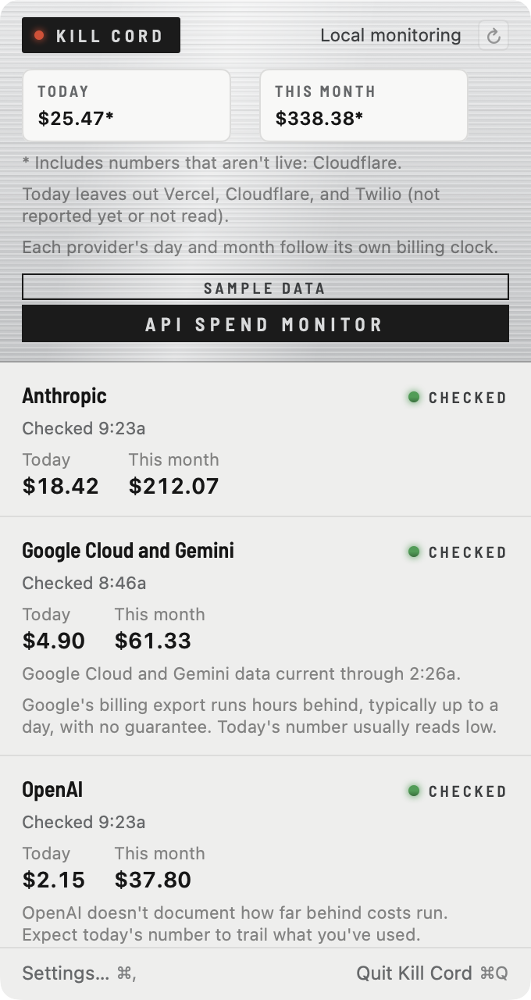
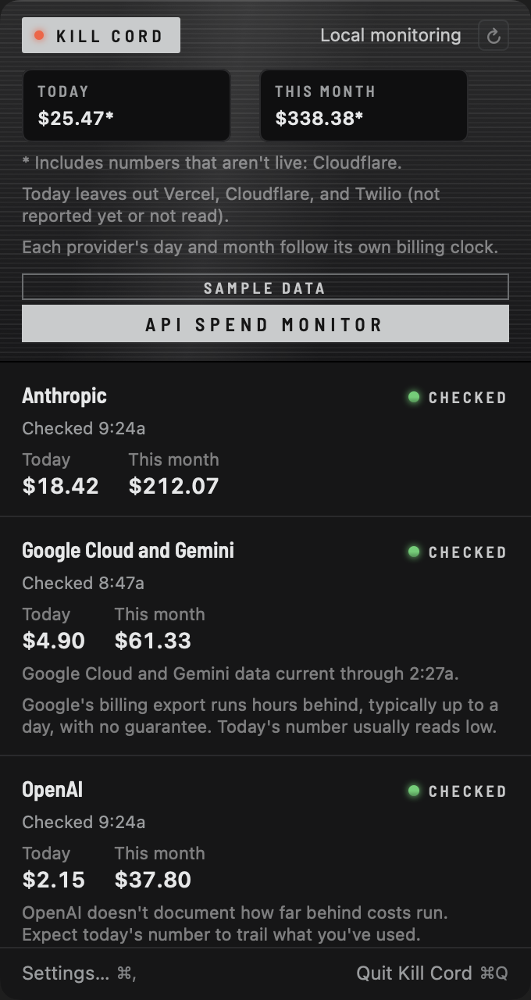

# v1 validation, November 16, 2026

Branch: `feature/1-v1-app`, PR [#1](https://github.com/coreyhaines31/killcord/pull/1).

## Verified locally

- Full Xcode 27.1 is installed at `/Applications/Xcode.app`; commands use `DEVELOPER_DIR=/Applications/Xcode.app/Contents/Developer` because the default selection points to Command Line Tools.
- Debug app build and `xcodebuild test`: exit 0.
- Universal Release build with `ONLY_ACTIVE_ARCH=NO CODE_SIGNING_ALLOWED=NO`: exit 0. `lipo -archs` reports `x86_64 arm64`.
- `swift test --package-path Packages/KillCordCore`: 113 tests in 19 suites pass on macOS. This includes temporary Keychain save/read/replace/delete/isolation and real RSA PKCS#1/PKCS#8 signature verification using an ephemeral key, with no provider credentials.
- `swiftlint lint --strict --quiet`: exit 0. Initial 28 violations are resolved; small scoped exceptions retain explicit billing logic and provider JSON fixture shapes.
- `bash -n Scripts/release.sh` and `git diff --check`: exit 0.
- The actual Debug app renders the PanelKit panel and all four settings panes in light/dark via `--demo --snapshot`. Reviewed panel, General, Providers, Alerts, and Caps Audit renders. Fixed truncated names and duplicated/compressed threshold fields found during this pass.
- Xcode emits its AppIntents metadata-skipped warning (no AppIntents dependency). This is not a warning-free build.

Screenshots use labeled sample data, not connected billing accounts:

| Light | Dark |
| --- | --- |
|  |  |

## Implementation choices

- PanelKit 0.2.0, pinned: real shared Brushed components, registered Barlow fonts, status-only colour, scrollable providers, and the family footer. Settings retain native macOS forms.
- Stable bundle ID `app.killcord.KillCord`; buying a domain does not require changing Keychain identity.
- Universal Mac build, macOS 14+.
- Neon remains usage-only, with no dollar estimates. Supabase remains manual caps audit only.
- Anthropic retains the documented legacy `GET /v1/organizations/cost_report`. [Current docs](https://platform.claude.com/docs/en/api/beta/organization/cost_report) still document it; the newer Analytics API is recommended for new integrations, but a migration is not validated here. Real-account validation remains required.
- Google uses the existing billing export plus service-account approach. [Official export setup](https://docs.cloud.google.com/billing/docs/how-to/export-data-bigquery-setup) remains a manual cloud-account task; nothing was provisioned or queried.
- Sparkle key generated in the login Keychain under `killcord`; only the public key is committed. Demo mode does not start update checks.
- Private macOS CI remains manual. Linux is pinned to Ubuntu 24.04 after an existing run failed before tests because setup-swift v2 rejected Ubuntu 26.04.

## Not yet verified or released

- No real provider calls or Google export provisioning. No actual notification delivery, sleep/wake, or credential-replacement UI smoke test. Keychain and signer tests verify their components, not complete account workflows.
- No Intel runtime test. No signing, notarization, Gatekeeper install, Sparkle update round trip, public downloads, or Homebrew publication.
- Repo stays private; its current GitHub release feed is not publicly accessible. No domain was bought. No branch was merged.

Assigned follow-ups: [real-provider and lifecycle QA #2](https://github.com/coreyhaines31/killcord/issues/2), [domain and distribution #3](https://github.com/coreyhaines31/killcord/issues/3), [Google setup #4](https://github.com/coreyhaines31/killcord/issues/4).
